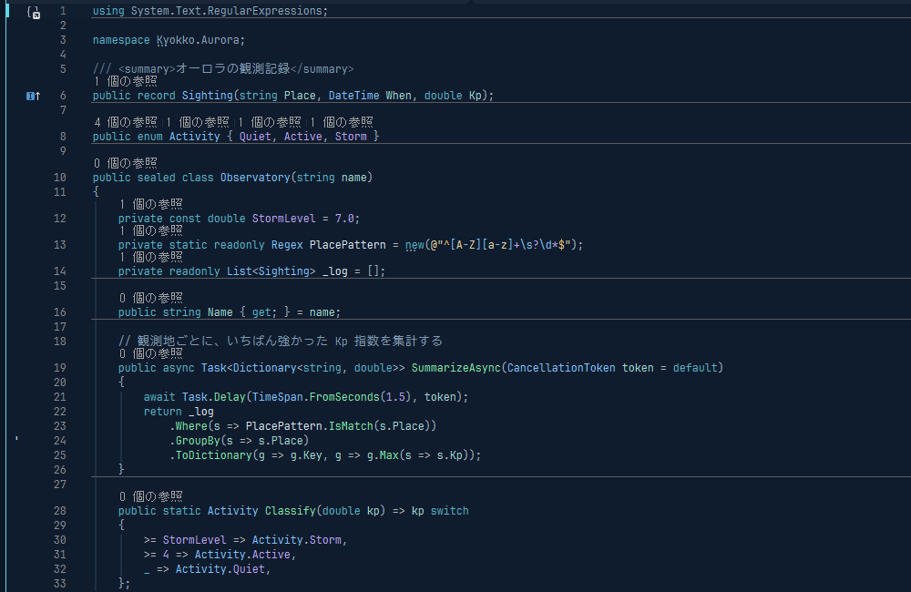

# Kyokko Theme

**Kyokko** (極光, *kyokkō*, "aurora") is a calm navy dark theme lit by aurora cyan and green.



- Navy background with one step lighter surfaces for tool windows, tabs and status bar
- Cyan keywords, green functions, sky-blue types, sand-colored strings, lilac numbers
- Comments in plain (non-italic) blue-gray, so Japanese comments stay readable
- Every code color is 5.9:1 or higher against the background (WCAG AA)
- In Visual Studio, the whole IDE is navy (no gray panels), and errors, warnings, find matches and the debugger's current line keep their usual meaning in dark tints

| Target | Status | File |
| --- | --- | --- |
| Visual Studio 2026 | [Visual Studio Marketplace](https://marketplace.visualstudio.com/items?itemName=dekunocode.KyokkoTheme) | `vs/` |
| Zed | Working (not published yet) | `themes/zed/kyokko.json` |
| Windows Terminal | Working | `themes/windows-terminal/kyokko.json` |
| VS Code | Planned | |

## Install

- **Visual Studio 2026**: install **Kyokko Theme** from the [Marketplace](https://marketplace.visualstudio.com/items?itemName=dekunocode.KyokkoTheme) (or **Extensions > Manage Extensions**, search for "Kyokko"), restart Visual Studio, then choose **Tools > Theme > Kyokko**.
- **Zed** and **Windows Terminal**: see [below](#zed).

## Palette

| Role | Color |
| --- | --- |
| Background / surface / selection | `#0f1c2e` / `#16263b` / `#24425e` |
| Text / comment | `#d4e4ec` / `#7f9bb0` |
| Keyword / function / type | `#56b6c6` / `#7ee8a8` / `#7cc4f8` |
| String / number | `#e6d9a2` / `#b9a3f0` |
| Property, parameter | `#9fd9d0` |

## How this repo works

`palette.json` is the single source of truth. Every theme file is generated from it:

```powershell
node scripts/build.mjs          # regenerate themes/ and vs/Kyokko.vstheme, print a contrast report
node scripts/build.mjs --check  # fail if a generated file is out of date (CI runs this)
```

Do not edit the generated files by hand; change `palette.json` (or the mapping in `scripts/build.mjs`) and rebuild.

### Visual Studio 2026

Requirements: Visual Studio 2026 with the **Visual Studio extension development** workload.

1. Open `Kyokko.slnx` and press **F5**. An experimental instance of Visual Studio starts with the theme installed.
2. In the experimental instance, choose **Tools > Theme > Kyokko**.
3. To try token changes live, use **Tools > Options > Environment > Visual Experience > Theme colors**, then copy the values you like back into `scripts/build.mjs`.

The `.vstheme` sets the new Visual Studio 2026 semantic tokens (`Shell`, `ShellInternal`) and falls back to the built-in Dark theme for anything not listed. Editor colors, including Roslyn semantic colors such as property and parameter names, use the classic editor categories.

Each push builds the VSIX on GitHub Actions; download it from the run's **Artifacts**.

The Marketplace page is `vs/marketplace/overview.md` with the screenshots next to it, published with `vs/publishManifest.json`:

```powershell
& "C:\Program Files\Microsoft Visual Studio\18\Community\VSSDK\VisualStudioIntegration\Tools\Bin\VsixPublisher.exe" publish -payload vs\bin\Release\net48\Kyokko.vsix -publishManifest vs\publishManifest.json -personalAccessToken <token>
```

### Zed

Copy `themes/zed/kyokko.json` to `%APPDATA%\Zed\themes\` and select **Kyokko** in the theme picker.

### Windows Terminal

Paste the contents of `themes/windows-terminal/kyokko.json` into `schemes` in `settings.json`, then set `"colorScheme": "Kyokko"`.

## License

[MIT](LICENSE.txt)
